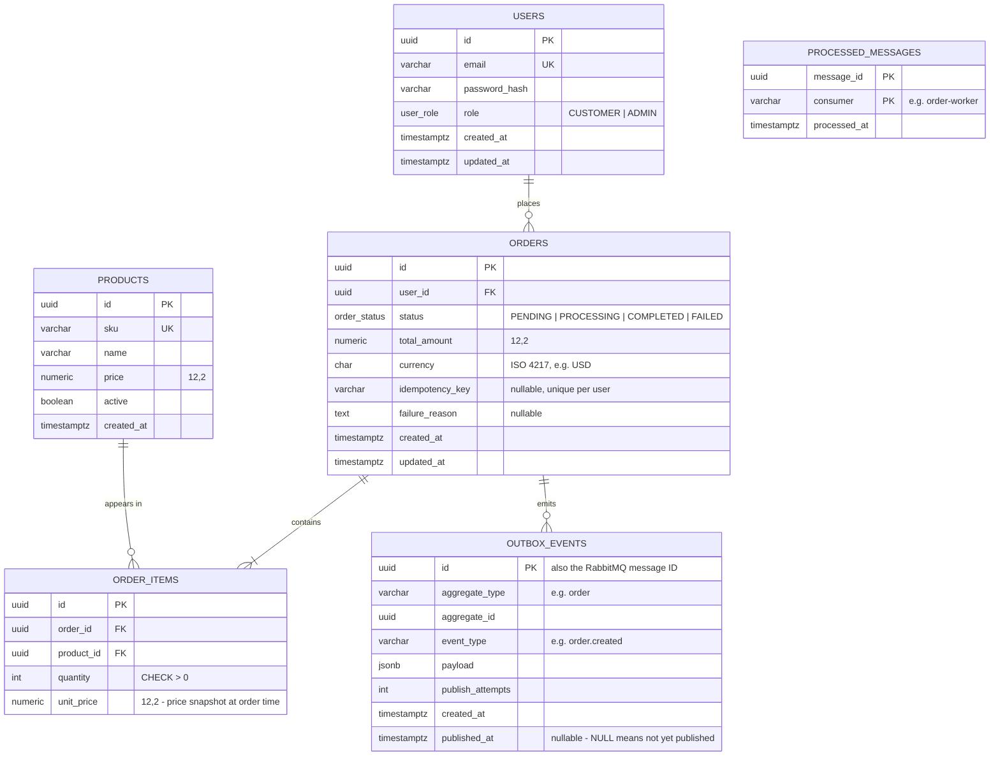
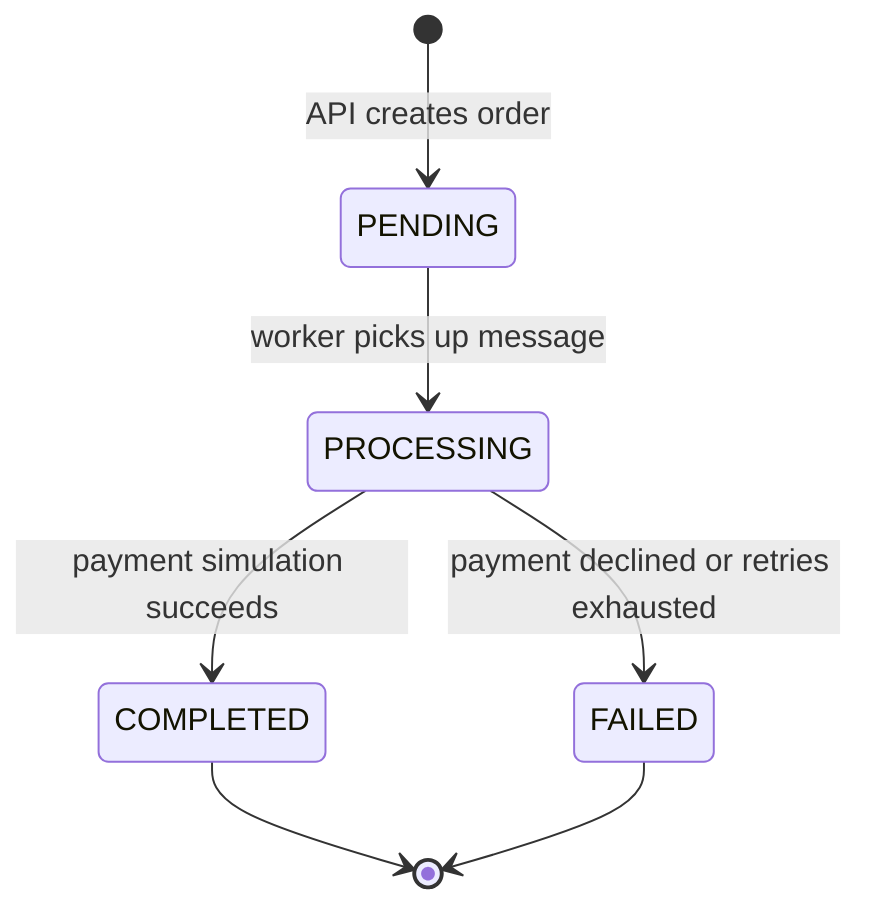

# Database Schema

PostgreSQL. Both services use the same database, with clear ownership rules (below). Migrations live in the Order API and run as a separate step, never on application startup.

## ER diagram

## Tables

### `users`
Customer and admin accounts. Passwords are stored only as hashes.

### `products`
A small seeded catalogue. It exists so that **prices come from the server**: a client sends a product ID and quantity, never a price.

### `orders`
- `total_amount` is calculated by the API from `order_items`.
- `idempotency_key` comes from an optional `Idempotency-Key` request header. A unique constraint on `(user_id, idempotency_key)` means a client or gateway retry of `POST /orders` returns the original order instead of creating a duplicate.
- `failure_reason` is set when the worker marks an order `FAILED`.

### `order_items`
`unit_price` is copied from `products.price` when the order is created, so later price changes don't alter past orders.

### `outbox_events` (transactional outbox)
When an order is created, the API inserts the order, its items **and** an `order.created` event in a **single transaction**. A relay inside the API polls for rows where `published_at IS NULL`, publishes them to RabbitMQ and then sets `published_at`.

This guarantees that an order is never saved without its event, or the reverse. The relay may publish the same event twice (for example, if it crashes after publishing but before updating the row). That's acceptable because the worker is idempotent.

Index: a partial index on `created_at WHERE published_at IS NULL`.

### `processed_messages` (idempotent consumer)
Before processing a message, the worker inserts `(message_id, consumer)` **in the same transaction** as the order status update. If the insert hits the primary key, the message was already handled, so the worker acknowledges it and skips it.

## Order status lifecycle

## Ownership rules (shared database)

Two services sharing one database is a deliberate simplification (see ADR-0001). Ownership is kept clear:

| Table | Written by | Read by |
|---|---|---|
| `users`, `products` | Order API | Order API |
| `orders`, `order_items` | Order API (create); Worker (status and `failure_reason` only) | Both |
| `outbox_events` | Order API | Order API |
| `processed_messages` | Worker | Worker |

Schema migrations are owned only by the Order API codebase. Each service will use its own database user with only the permissions it needs; that's set up in the infrastructure sprints.
